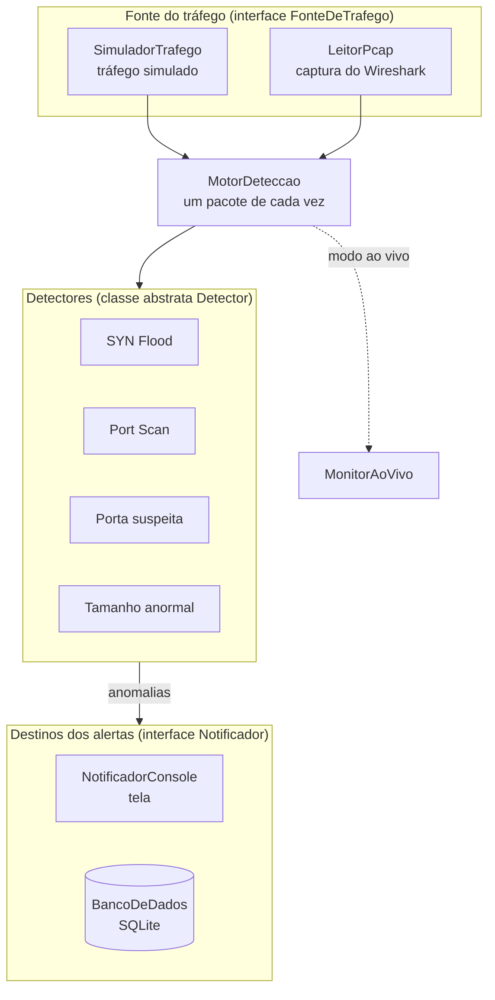
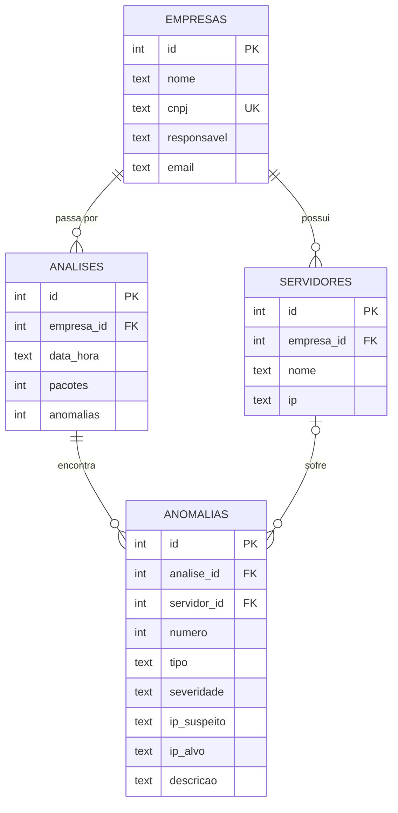
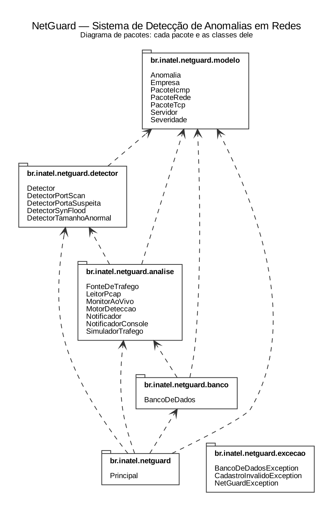

<div align="center">

# NetGuard

### Sistema de Detecção de Anomalias em Redes

Cadastre empresas e seus servidores, analise o tráfego que chega a eles e descubra
ataques como **SYN Flood**, **varredura de portas** e **acesso a portas suspeitas**,
com tráfego simulado ou capturado de verdade com o Wireshark.


-1679A7?logo=wireshark&logoColor=white)


**C06 – Programação Orientada a Objetos** · Projeto Final (NP2) · Inatel · Prof. Christopher Lima

</div>

---

## Contents

- [Introdução](#introdução)
- [Funcionalidades](#funcionalidades)
- [Como funciona](#como-funciona)
- [Demonstração](#demonstração)
- [Como executar](#como-executar)
- [Analisar a sua própria rede (Wireshark)](#analisar-a-sua-própria-rede-wireshark)
- [Orientação a Objetos no projeto](#orientação-a-objetos-no-projeto)
- [Banco de dados](#banco-de-dados)
- [Diagrama UML](#diagrama-uml)
- [Estrutura do repositório](#estrutura-do-repositório)
- [Critérios do edital](#critérios-do-edital)
- [Integrantes](#integrantes)
- [Uso de Inteligência Artificial](#uso-de-inteligência-artificial)
- [Limitações conhecidas](#limitações-conhecidas)

---

## Introdução

Toda empresa conectada à internet recebe, o tempo todo, tráfego que não pediu: robôs testando
portas abertas, tentativas de derrubar servidores com excesso de conexões, acessos a serviços
inseguros. Quem vigia isso é um **IDS** (*Intrusion Detection System*, sistema de detecção de
intrusão): um programa que olha os pacotes que passam pela rede e avisa quando algo foge do normal.

O **NetGuard** é uma versão didática de um IDS, escrita em **Java com Orientação a Objetos**.
Ele mantém um cadastro de empresas e dos servidores de cada uma, analisa o tráfego destinado a
esses servidores pacote por pacote e, ao encontrar um padrão de ataque, gera um alerta com a
gravidade, a origem e o alvo. Tudo fica guardado em um banco de dados, para consultar o
histórico e ver quem mais ataca e quem mais é atacado.

O projeto une as duas pontas do curso: **Redes de Computadores** (Ethernet, IPv4, TCP, ICMP,
portas, MTU, ataques de negação de serviço e varredura) e **Programação Orientada a Objetos**
(classes, herança, classes abstratas, interfaces, polimorfismo e tratamento de exceções).

<sub>[↑ Voltar ao índice](#contents)</sub>

## Funcionalidades

| | Funcionalidade | Descrição |
|---|---|---|
| 🏢 | **Cadastro de empresas** | Nome, CNPJ (validado e único), responsável e e-mail |
| 🖥️ | **Cadastro de servidores** | Nome e endereço IPv4 (validado), ligados a uma empresa |
| 🔍 | **Análise de tráfego** | 20.000 pacotes simulados **ou** uma captura real `.pcap` do Wireshark |
| 🚨 | **Quatro detectores** | SYN Flood, Port Scan, Porta suspeita e Tamanho anormal |
| 📺 | **Modo ao vivo** | O tráfego rola na tela durante a análise, com os pacotes suspeitos destacados |
| 🗄️ | **Banco de dados** | Cadastro, análises e alertas salvos em SQLite |
| 📜 | **Histórico** | Últimas análises e alertas da mais recente, do mais grave ao menos grave |
| 📊 | **Relatório de anomalias** | Ataques de uma empresa agrupados por tipo, por IP de origem e por servidor atacado |

### Os detectores

| Ataque | Como é reconhecido | Gravidade |
|--------|--------------------|-----------|
| **SYN Flood** | Mais de 100 pedidos de conexão TCP (SYN) do mesmo IP em 1 segundo | 🔴 Crítica |
| **Port Scan** | Mais de 20 portas diferentes do mesmo servidor testadas pelo mesmo IP em 3 segundos | 🟠 Alta |
| **Porta suspeita** | Tráfego para portas como 23 (Telnet), 4444 (Metasploit), 6667 (IRC) e 31337 | 🟠 Alta |
| **Tamanho anormal** | Pacote IP maior que 1.500 bytes, a MTU de uma rede Ethernet ou Wi-Fi | 🟡 Baixa |

### O menu

```
=== NETGUARD - Detecção de Anomalias em Redes ===
1 - Cadastrar empresa
2 - Cadastrar servidor
3 - Listar empresas e servidores
4 - Excluir empresa
5 - Excluir servidor
6 - Analisar a rede de uma empresa
7 - Ver histórico de análises
8 - Relatório de anomalias da rede de uma empresa
0 - Sair
```

<sub>[↑ Voltar ao índice](#contents)</sub>

## Como funciona



1. Escolhida uma empresa, o tráfego vem de uma das duas **fontes**. As duas implementam a mesma
   interface, então o resto do sistema não sabe se ele é simulado ou real.
2. O **motor** entrega cada pacote a todos os **detectores**. Cada detector aplica a sua regra
   e, se encontrar um ataque, devolve uma **anomalia**.
3. Cada anomalia vai para todos os **notificadores**: aparece na tela e é gravada no banco,
   ligada ao servidor atacado.
4. No **modo ao vivo**, o monitor mostra uma amostra do tráfego (1 pacote a cada 200), todos os
   pacotes suspeitos e o progresso a cada 25%.

<sub>[↑ Voltar ao índice](#contents)</sub>

## Demonstração

**Análise com o modo ao vivo** (opção 6): o ataque aparece no meio do tráfego normal, com o alerta
logo abaixo do pacote que o disparou.

```
Analisando 20000 pacotes para a empresa Empresa Exemplo (tráfego simulado para 3 servidor(es))...

---------------- TRÁFEGO AO VIVO ----------------
  [ 2800] TCP 192.168.1.39:52206 -> 10.0.0.20:80 114 bytes
  [ 3000] TCP 192.168.1.41:63940 -> 10.0.0.25:443 196 bytes
  [ 3101] TCP 203.0.113.66:60885 -> 10.0.0.10:80 [SYN] 60 bytes   <<< SUSPEITO
[ALERTA] #1 [CRITICA] 16:03:00 | SYN Flood | de 203.0.113.66 | 101 pedidos de conexão em 1000 ms contra 10.0.0.10:80 (limite: 100)
  [ 3200] TCP 203.0.113.66:62026 -> 10.0.0.10:80 [SYN] 60 bytes
  ...... 5000 de 20000 pacotes analisados (25%), 1 alerta(s) até agora ......
```

**Relatório de anomalias da rede** (opção 8):

```
=============== ANOMALIAS DA REDE: Empresa Exemplo ===============
Análises feitas: 1 | anomalias registradas: 6

------- POR TIPO DE ATAQUE -------
  Porta suspeita [ALTA]                  2  ##############################
  Tamanho anormal [BAIXA]                2  ##############################
  Port Scan [ALTA]                       1  ###############
  SYN Flood [CRITICA]                    1  ###############

------- POR SERVIDOR (quem foi atacado) -------
  Servidor de E-mail (10.0.0.25)         2  ##############################
  Servidor de Arquivos (10.0.0.20)       2  ##############################
  Servidor Web (10.0.0.10)               2  ##############################
```

<sub>[↑ Voltar ao índice](#contents)</sub>

## Como executar

**Requisito:** JDK 17 ou mais novo. O driver do SQLite já vem na pasta `lib`; não é preciso
instalar mais nada.

| Onde | Como |
|------|------|
| **Windows** | Dois cliques em **`executar.bat`**, ou `.\executar.bat` no PowerShell, dentro da pasta do projeto |
| **Linux / macOS** | `./executar.sh` |
| **IDE** (IntelliJ, Eclipse, VS Code) | Abra a pasta (a IDE lê o `pom.xml`) e execute `br.inatel.netguard.Principal` |

Pelo terminal, sem o script (Windows):

```powershell
javac -encoding UTF-8 -d out -cp lib\sqlite-jdbc-3.47.1.0.jar -sourcepath src\main\java src\main\java\br\inatel\netguard\Principal.java
java -cp "out;lib\sqlite-jdbc-3.47.1.0.jar" br.inatel.netguard.Principal
```

No Linux e no macOS, troque `\` por `/` e o `;` do classpath por `:`.

> [!TIP]
> Na primeira execução o banco está vazio, então o programa cadastra sozinho uma **Empresa
> Exemplo** com 3 servidores. Basta escolher a opção **6**, a empresa **1**, a fonte **1** e
> responder **s** para ver a análise ao vivo.

<sub>[↑ Voltar ao índice](#contents)</sub>

## Analisar a sua própria rede (Wireshark)

> [!WARNING]
> **Só analise a sua própria rede, ou uma rede em que você tenha autorização.** Capturar o
> tráfego de outras pessoas (Wi-Fi de café, da faculdade, de vizinhos) é interceptação de
> comunicação e é crime. Varrer portas de equipamentos que não são seus também não é permitido.

1. Instale o [Wireshark](https://www.wireshark.org/) (no Windows, junto com o Npcap).
2. Rode `ipconfig` e anote o IPv4 do seu computador e o **Gateway Padrão** (o seu roteador).
3. No NetGuard, cadastre uma empresa (por exemplo, "Minha Casa") e um servidor "Roteador" com o
   IP do gateway.
4. No Wireshark, capture a interface **Wi-Fi**. Navegue, rode `ping` no roteador e, para ver
   alertas, rode `nmap <ip-do-seu-roteador>` ([nmap.org](https://nmap.org/)).
5. Pare a captura e use **Arquivo > Salvar como**, com o tipo **"Wireshark/tcpdump/... - pcap"**.
   O formato padrão, pcapng, não é aceito.
6. No NetGuard: opção 6 → a empresa → fonte `2` → o caminho do arquivo.

> [!NOTE]
> O repositório traz `exemplos/captura-exemplo.pcap` para teste. **Ela não foi gravada em uma
> rede real:** foi gerada por um script, com os bytes de cada pacote montados como uma placa de
> rede gravaria. Ela imita navegação HTTPS, DNS, pings e uma varredura estilo nmap do computador
> `192.168.0.15` contra o roteador `192.168.0.1`. O resultado são alertas de Port Scan, SYN
> Flood, Porta suspeita (Telnet) e Tamanho anormal; a navegação normal não gera alerta.

<sub>[↑ Voltar ao índice](#contents)</sub>

## Orientação a Objetos no projeto

### Pacotes

O código tem **24 tipos em 5 pacotes**, cada pacote com uma responsabilidade:

| Pacote | Responsabilidade | Tipos |
|--------|------------------|-------|
| `br.inatel.netguard` | Ponto de entrada e menu | `Principal` |
| `modelo` | Os dados do sistema | `Empresa`, `Servidor`, `PacoteRede`, `PacoteTcp`, `PacoteIcmp`, `Anomalia`, `Severidade` |
| `detector` | As regras de detecção | `Detector`, `DetectorSynFlood`, `DetectorPortScan`, `DetectorPortaSuspeita`, `DetectorTamanhoAnormal` |
| `analise` | O processo de análise | `MotorDeteccao`, `MonitorAoVivo`, `FonteDeTrafego`, `SimuladorTrafego`, `LeitorPcap`, `Notificador`, `NotificadorConsole` |
| `banco` | Persistência | `BancoDeDados` |
| `excecao` | Os erros do sistema | `NetGuardException`, `CadastroInvalidoException`, `BancoDeDadosException` |

### Conceitos aplicados

| Conceito | Onde está |
|----------|-----------|
| **Encapsulamento** | Atributos `private final` em `Empresa`, `Servidor`, `PacoteRede` e `Anomalia`; os construtores validam tudo, então não existe objeto inválido |
| **Sobrecarga de construtores** | `Empresa`, `Servidor` e `Anomalia`: um construtor para dados novos, outro para dados lidos do banco (`this(...)`) |
| **Membros `static`** | Contador de anomalias e `Anomalia.continuarNumeracaoApos(...)`; `PacoteRede.ehIpv4Valido(...)` |
| **Enum** | `Severidade` (BAIXA, MEDIA, ALTA, CRITICA), com peso para comparação |
| **Associação 1:N** | Uma `Empresa` tem uma `List<Servidor>` |
| **Herança** | `PacoteRede` → `PacoteTcp`, `PacoteIcmp` · `Detector` → 4 detectores · `NetGuardException` → 2 exceções |
| **Classes abstratas** | `PacoteRede` (não existe pacote "genérico") e `Detector` (Template Method: `analisar()` é `final` e chama o abstrato `inspecionar()`) |
| **Interfaces** | `Notificador` e `FonteDeTrafego` (nossas); `Comparable` (do Java), para ordenar as anomalias |
| **Polimorfismo** | `detector.analisar(pacote)`, `notificador.notificar(anomalia)`, `fonte.obterPacotes()` e `pacote.descrever()`: a mesma chamada executa código diferente conforme o objeto |
| **Tratamento de exceções** | Hierarquia de exceções checadas, tradução de `SQLException`/`IOException`, `try/catch/finally` (a conexão com o banco é fechada no `finally`) |

O melhor exemplo de por que a arquitetura funciona: o detector de **Port Scan** e a leitura de
**arquivos `.pcap`** entraram no projeto sem mudar uma linha do motor. Bastou uma classe que
estende `Detector` e outra que implementa `FonteDeTrafego`.

<sub>[↑ Voltar ao índice](#contents)</sub>

## Banco de dados

**SQLite**, em um único arquivo (`dados/netguard.db`, criado na primeira execução), acessado
por **JDBC**. Todo o SQL fica na classe `BancoDeDados`, sempre com `PreparedStatement`, o que
protege contra SQL Injection.



- Ao excluir uma empresa, o banco apaga junto os servidores e as análises dela
  (`ON DELETE CASCADE`).
- Um servidor não pode ter o IP repetido dentro da mesma empresa (`UNIQUE`).
- O histórico e o relatório usam `JOIN`, `GROUP BY` e `COUNT`.

Para ver o conteúdo fora do programa, abra `dados/netguard.db` no
[DB Browser for SQLite](https://sqlitebrowser.org/).

> [!NOTE]
> **Por que SQLite e não MySQL?** O SQLite guarda o banco inteiro em um arquivo e não precisa de
> servidor instalado, então o projeto roda em qualquer computador só com o Java. O SQL usado é o
> mesmo do MySQL (`CREATE TABLE`, `INSERT`, `JOIN`, `GROUP BY`). Como todo o SQL está na classe
> `BancoDeDados`, trocar para MySQL mexeria só nessa classe e no driver.

<sub>[↑ Voltar ao índice](#contents)</sub>

## Diagrama UML

O diagrama de classes completo, com todos os atributos, métodos e relacionamentos, está em
[`docs/uml/diagrama-classes-completo.pdf`](docs/uml/diagrama-classes-completo.pdf) (também em
[PNG](docs/uml/diagrama-classes-completo.png) e [SVG](docs/uml/diagrama-classes-completo.svg)).
Há um diagrama por pacote em [`docs/uml/pacotes/`](docs/uml/pacotes/).

Os diagramas seguem a notação usada nas aulas: classes abstratas em itálico, `<<interface>>` acima
do nome, herança com linha cheia e triângulo vazado, implementação com linha tracejada, agregação
(listas) com losango vazado e multiplicidade, e `+` `-` `#` para a visibilidade.

**Diagrama de pacotes** (cada pacote e as suas classes):



<sub>[↑ Voltar ao índice](#contents)</sub>

## Estrutura do repositório

```
├── src/main/java/br/inatel/netguard/
│   ├── Principal.java       menu: cadastro, análise, histórico e relatório
│   ├── modelo/              dados: empresas, servidores, pacotes, anomalias
│   ├── detector/            os quatro detectores e a classe abstrata Detector
│   ├── analise/             motor, monitor ao vivo, fontes de tráfego, notificadores
│   ├── banco/               BancoDeDados (SQLite via JDBC)
│   └── excecao/             exceções do sistema
├── lib/                     driver JDBC do SQLite
├── exemplos/                captura-exemplo.pcap (gerada por script, para teste)
├── docs/uml/                diagramas UML (completo e por pacote)
├── executar.bat             compila e executa no Windows
├── executar.sh              compila e executa no Linux/macOS
└── pom.xml                  projeto Maven (para abrir na IDE)
```

<sub>[↑ Voltar ao índice](#contents)</sub>

## Critérios do edital

| # | Critério | Onde ver no projeto |
|---|----------|---------------------|
| 01 | Boas práticas | Pacotes por responsabilidade, atributos `private final`, constantes nomeadas, Javadoc, convenções do Java |
| 02 | Classes | 24 tipos com atributos, construtores e métodos; ex.: `Empresa`, `Anomalia`, `BancoDeDados` |
| 03 | Herança | `PacoteRede` → `PacoteTcp`/`PacoteIcmp`; `Detector` → 4 detectores; `NetGuardException` → 2 exceções |
| 04 | Polimorfismo | Listas de `Detector` e `Notificador` no `MotorDeteccao`; `FonteDeTrafego` no menu; `descrever()` nos pacotes |
| 05 | Interfaces **e** classes abstratas | Interfaces `Notificador` e `FonteDeTrafego`; classes abstratas `PacoteRede` e `Detector` |
| 06 | Tratamento de erros | 3 exceções próprias, validação nos construtores, `try/catch` no menu, `finally` para fechar o banco |
| 07 | Arquivos **ou** banco de dados | Os dois: SQLite via JDBC em `BancoDeDados` e leitura de arquivos `.pcap` em `LeitorPcap` |
| 08 | Threads | **Não utilizadas, por orientação do professor.** A análise é sequencial, um pacote de cada vez |
| 09 | UML completo | [`docs/uml/`](docs/uml/) |
| 10 | Repositório | Este repositório |
| 11 | Relevância ao curso | Redes e segurança: camadas Ethernet, IPv4, TCP e ICMP lidas byte a byte, portas, MTU, varredura e negação de serviço |
| 12 | Uso de IA | [Seção abaixo](#uso-de-inteligência-artificial) |

<sub>[↑ Voltar ao índice](#contents)</sub>

## Integrantes

| Integrante |
|------------|
| Luigi Prado Raimundo |
| Evelyn Maria de Oliveira Silva |
| João Vitor Custódio |
| Mateus Franco de Oliveira |

<sub>[↑ Voltar ao índice](#contents)</sub>

## Uso de Inteligência Artificial

**O grupo utilizou ferramentas de IA como apoio ao desenvolvimento do projeto.**

**Ferramenta utilizada:** Claude, da Anthropic, por meio do aplicativo Claude.

**Aplicações durante o desenvolvimento:**

A ferramenta foi utilizada em diferentes etapas do projeto, principalmente como suporte à estruturação, implementação e documentação do sistema.

- **Planejamento e arquitetura:** apoio na definição da organização do projeto, incluindo pacotes, hierarquia de classes, interfaces e estrutura do banco de dados, considerando o tema e os critérios estabelecidos pelo edital.
- **Desenvolvimento:** assistência na implementação das funcionalidades em Java, como cadastro de empresas e servidores, armazenamento de informações, monitoramento do tráfego de rede e identificação de anomalias.
- **Evolução das funcionalidades:** apoio na inclusão do modo de monitoramento ao vivo, geração de relatórios, identificação de atividades suspeitas de Port Scan e leitura de arquivos de captura `.pcap`, incluindo a integração com a interface `FonteDeTrafego` e a classe `LeitorPcap`.
- **Revisão e aperfeiçoamento:** utilização da ferramenta para analisar o código, identificar inconsistências e realizar ajustes, como melhorias na validação de endereços IP e na numeração dos registros de anomalias.
- **Documentação e testes:** auxílio na elaboração dos diagramas UML, dos scripts de execução, do README e de uma documentação de apoio para compreensão das decisões de projeto e dos conceitos de orientação a objetos aplicados.

A utilização da IA ocorreu de forma orientada pelos requisitos e pelas necessidades identificadas pelo grupo. As funcionalidades foram definidas e refinadas ao longo do desenvolvimento, a partir das solicitações, avaliações e ajustes realizados pelos integrantes.

<sub>[↑ Voltar ao índice](#contents)</sub>

## Limitações conhecidas

- Não há captura ao vivo na placa de rede: o tráfego real vem de um arquivo gravado pelo
  Wireshark.
- O leitor aceita só o formato pcap (não o pcapng) e só IPv4; o arquivo é lido inteiro para a
  memória.
- As regras usam limites fixos, sem aprendizado do comportamento normal da rede.
- A análise é sequencial: o projeto não usa threads, por orientação do professor.
- Não há edição de cadastro: para corrigir um dado, exclua e cadastre de novo.
- O simulador usa uma semente fixa (`Random(42)`): a mesma empresa gera sempre o mesmo tráfego, o
  que deixa a demonstração previsível; por isso análises repetidas encontram os mesmos ataques.
- A validação do CNPJ confere só os 14 dígitos, não os dígitos verificadores.

<sub>[↑ Voltar ao índice](#contents)</sub>

---

<div align="center">
<sub>Inatel · C06 – Programação Orientada a Objetos · Prof. Christopher Lima</sub>
</div>
